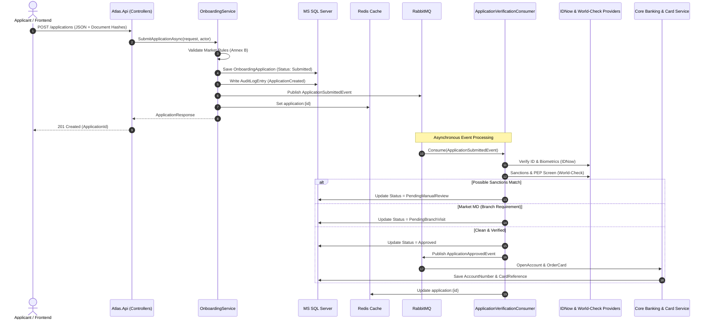

# Atlas Digital Onboarding Platform

[](https://dotnet.microsoft.com/)
[]()
[]()
[]()
[]()
[]()

Atlas is an enterprise-grade digital banking onboarding backend built with **.NET 8**, **Entity Framework Core**, **MassTransit**, **RabbitMQ**, and **Redis**. It coordinates end-to-end customer registration across multiple European and global jurisdictions with strict regulatory compliance, asynchronous identity verification, sanctions screening, automated core banking account provisioning, and tamper-evident audit trails.

---

## Table of Contents

- [Architectural Decisions & Rationale](#architectural-decisions--rationale)
  - [1. Domain-Driven Design (DDD) & Clean Architecture](#1-domain-driven-design-ddd--clean-architecture)
  - [2. Modular Monolith vs. Microservices](#2-modular-monolith-vs-microservices)
  - [3. RabbitMQ vs. In-Memory Messaging](#3-rabbitmq-vs-in-memory-messaging)
  - [4. Redis Distributed Cache vs. Direct Database Queries](#4-redis-distributed-cache-vs-direct-database-queries)
  - [5. Document SHA-256 Hashes in SQL vs. Cloud Object Storage (S3 / Blob)](#5-document-sha-256-hashes-in-sql-vs-cloud-object-storage-s3--blob)
  - [6. Additional Engineering & Compliance Highlights](#6-additional-engineering--compliance-highlights)
- [Multi-Market Compliance Engine (Annex B)](#multi-market-compliance-engine-annex-b)
- [System Architecture & Processing Flow](#system-architecture--processing-flow)
- [Technology Stack](#technology-stack)
- [Project Structure](#project-structure)
- [API Reference & Headers](#api-reference--headers)
- [Local Development & Setup](#local-development--setup)
- [Testing & Quality Assurance](#testing--quality-assurance)

---

## Architectural Decisions & Rationale

### 1. Domain-Driven Design (DDD) & Clean Architecture

Digital banking onboarding is subject to dense, evolving compliance directives and high-risk regulatory constraints. Choosing **Domain-Driven Design (DDD)** ensures that business rules and legal invariants are not scattered across API controllers or database queries, but instead live exclusively within the domain layer.

* **Encapsulated Aggregate Roots (`OnboardingApplication`):** All state changes (status transitions, document additions, verification outcomes, manual review approvals) are guarded by aggregate methods. It is impossible to bypass required steps, transition to illegal states, or modify finalized records.
* **Separation of Concerns:** Following Clean/Onion Architecture principles, inner layers (`Atlas.Domain`) have zero external dependencies. Application orchestration (`Atlas.Application`) defines interfaces, while external technologies (EF Core, MassTransit, Redis, external KYC vendors) are pluggable adapters in `Atlas.Infrastructure`.
* **Ubiquitous Language:** Core terms—such as *Applicant*, *MarketRule*, *IdentityVerification*, *SanctionsScreening*, *ManualReview*, and *RightToErasure*—directly mirror legal compliance notices and banking domain standards.

---

### 2. Modular Monolith vs. Microservices

Instead of decomposing the application prematurely into multiple distributed microservices, Atlas was intentionally designed as a **Modular Monolith**.

* **Avoidance of Distributed System Overhead:** Microservices introduce distributed transactions (sagas/2PC), network latency, partial failures, split-brain risks, service discovery overhead, and continuous operational complexity. At this stage, paying that "distributed systems tax" would reduce development velocity without delivering tangible benefits.
* **Strict Transactional Boundaries & Consistency:** Onboarding requires ACID consistency across application state changes and regulatory audit logging. A modular monolith guarantees atomic operations within a single database transaction without fragile distributed synchronization.
* **High Modularity with Easy Extraction Path:** By decoupling layers through distinct projects (`Atlas.Domain`, `Atlas.Application`, `Atlas.Infrastructure`, `Atlas.Api`) and asynchronous message contracts via MassTransit, any bounded context (e.g., Sanctions/PEP Screening or Card Issuance) can be extracted into an independent microservice in the future with minimal refactoring if traffic profiles diverge.

---

### 3. RabbitMQ vs. In-Memory Messaging

Rather than using in-process event dispatchers (`System.Threading.Channels` or MediatR notifications), Atlas integrates **RabbitMQ** orchestrated with **MassTransit**:

* **Reliability & Message Durability:** In a financial institution, dropping a verification or account provisioning request due to an unhandled exception, server crash, or deployment restart is intolerable. In-memory queues are volatile and lost on crash. RabbitMQ persists messages to disk, guaranteeing at-least-once delivery.
* **Decoupling Heavy Third-Party Latency:** External verification partners (e.g., IDNow video/photo biometric processing and World-Check PEP/Sanctions screening) are slow I/O operations with unpredictable latency. RabbitMQ offloads this work from the HTTP request thread, allowing the API to acknowledge customer requests in milliseconds (`201 Created`) while verification runs asynchronously in the background.
* **Backpressure, Rate Limiting & Competing Consumers:** When peak traffic surges, RabbitMQ queues buffer incoming volume, shielding external vendor APIs from rate-limit exhaustion. Worker consumers can scale out horizontally across multiple instances to pull work at their own pace.
* **Enterprise Retry Policies & Dead-Letter Exchanges (DLQ):** Configured via MassTransit to perform automated retry intervals on transient network faults (`Interval(3, 2s)`). Poison pills or irrecoverable errors are routed safely to dead-letter queues without halting downstream processing.

---

### 4. Redis Distributed Cache vs. Direct Database Queries

The application incorporates a distributed **Redis** caching tier instead of querying SQL Server directly on every read:

* **Sub-Millisecond Status Polling:** During onboarding, mobile apps and client portals poll the status endpoint (`GET /applications/{id}`) repeatedly while background identity and sanctions checks execute. Serving these reads directly from Redis sub-millisecond memory drastically minimizes latency.
* **SQL Server Load Offloading:** Bypasses relational queries, foreign key joins, and execution plan compilations for hot application records, keeping SQL Server connection pool resources reserved for mission-critical write transactions.
* **Distributed Multi-Node Parity:** In a horizontally scaled production deployment with multiple API instances behind a load balancer, standard in-memory caching (`IMemoryCache`) causes inconsistent, fragmented cache states. Redis provides a unified, cluster-wide caching layer.
* **Controlled TTL & Coherent Invalidation:** Application state responses are cached with a short 5-minute time-to-live (TTL) and explicitly invalidated/updated upon every state mutation (verification updates, branch visits, manual reviews, and GDPR erasure requests).

---

### 5. Document SHA-256 Hashes in SQL vs. Cloud Object Storage (S3 / Blob)

Atlas stores cryptographic **SHA-256 content hashes** in the primary Microsoft SQL Server database rather than persisting raw document files into cloud object storage (AWS S3, Azure Blob Storage, or Google Cloud Storage):

* **Cost & Infrastructure Subscription Constraints:** Cloud object storage incurs recurring monthly subscription costs, tiering management, API request costs (PUT/GET), and egress bandwidth fees. By storing compact hashes directly in the relational database, Atlas operates self-contained in on-premise environments, air-gapped systems, or containerized developer environments without requiring active cloud provider subscriptions.
* **Privacy-by-Design & PII Minimization:** Biometric selfies and passport/ID scans contain extremely sensitive Personally Identifiable Information (PII). Permanently storing raw images creates high-value targets for data breaches. Computing and saving the SHA-256 hash immediately upon submission validates document integrity and provides cryptographic non-repudiation without persisting raw biometric files in permanent storage.
* **Compliance with GDPR Right to Erasure:** Storing only hashes and structured metadata vastly simplifies GDPR data deletion obligations (Compliance Notice GC-2026-0814 #5). Scrubbing customer references in the relational database completely erases identifiable trace data without leaving orphaned binary objects across cloud storage buckets and secondary backup tiers.
* **Atomic Consistency:** Document metadata and hashes reside in the exact same database transaction as the onboarding application aggregate, eliminating distributed inconsistencies (e.g., dangling files in S3 if the database transaction aborts).

---

### 6. Additional Engineering & Compliance Highlights

Beyond the core stack, Atlas incorporates several production-grade patterns:

* **Strict Audit Trail (10-Year AML Retention):** Every read and state mutation is logged into an immutable `AuditLogEntry` table with attribution to the executing actor (`X-Caller-Id` or `X-Officer-Id`), timestamped and marked with a mandatory 10-year retention date per Anti-Money Laundering regulations (Notice GC-2026-0814 #4).
* **Human-in-the-Loop Sanctions Governance:** If World-Check screening identifies a `PossibleMatch` (PEP or Sanctions match), automated processing is immediately suspended, and the application transitions to `PendingManualReview`. Compliance officers must inspect the profile and provide formal justification before any account can be activated.
* **GDPR Right to Erasure Pipeline:** Customers can request personal data erasure (`DELETE /applications/{id}/erasure`). The system anonymizes names, emails, phones, and document hashes while retaining non-identifying regulatory audit timestamps and market codes.
* **Centralized Structured Logging with Serilog & Seq:** All events, HTTP requests, consumer activities, and error traces are captured with rich contextual properties and pushed directly into a Seq log aggregator for real-time monitoring and querying.

---

## Multi-Market Compliance Engine (Annex B)

Atlas supports multi-jurisdictional onboarding via an extensible rules engine (`IMarketRule` & `MarketRuleRegistry`), enforcing jurisdiction-specific national identification validation and branch requirements:

| Market Code | Rule Name | Identifier Validation Rules | Special Requirements |
| :--- | :--- | :--- | :--- |
| **MA** | Market MA Rule | 13-digit Personal Number (`^\d{13}$`) | Fully digital onboarding |
| **MB** | Market MB Rule | 13-digit Personal Number (`^\d{13}$`) | Fully digital onboarding |
| **MC** | Market MC Rule | 9-character Unified Citizen ID, ending in an alphabetical letter (`^[a-zA-Z0-9]{8}[a-zA-Z]$`) | Fully digital onboarding |
| **MD** | Market MD Rule | 10-digit Citizen Number (`^\d{10}$`) | **Mandatory in-person branch visit** with wet signature verification prior to activation |
| **ME** | Market ME Rule | 10-digit Civil Number with **Modulo 11 check-digit verification** algorithm | Fully digital onboarding |
| **MF** | Market MF Rule | 9-digit National Identity Number, or a valid Passport Number in lieu of National ID | Fully digital onboarding |

---

## System Architecture & Processing Flow



---

## Technology Stack

* **Runtime & Framework:** .NET 8 (C# 12) / ASP.NET Core Web API
* **Database & ORM:** Microsoft SQL Server 2022, Entity Framework Core 8
* **Message Broker & Bus:** RabbitMQ with MassTransit
* **Distributed Caching:** Redis (`StackExchange.Redis` / `Microsoft.Extensions.Caching.StackExchangeRedis`)
* **Logging & Observability:** Serilog with Console & Seq Sinks
* **API Documentation:** Swagger / OpenAPI UI
* **Containerization:** Docker & Docker Compose
* **Testing:** xUnit, FluentAssertions, Moq, EF Core In-Memory

---

## Project Structure

```
AtlasBackend/
├── platform/
│   └── docker-compose.yml             # SQL Server, Redis, RabbitMQ & Seq orchestration
├── AtlasBackend/
│   ├── Atlas.Domain/                  # Core Business Domain (Zero External Dependencies)
│   │   ├── Common/                    # AggregateRoot, Entity base classes
│   │   ├── Exceptions/                # DomainException, MarketValidationException
│   │   ├── Model/Applicants/          # Applicant, Document entities
│   │   ├── Model/Applications/        # OnboardingApplication aggregate, ApplicationStatus enum
│   │   ├── Model/Markets/             # Market rules engine (MA, MB, MC, MD, ME, MF)
│   │   ├── Model/Verifications/       # IDNow & World-Check verification records
│   │   ├── Audit/                     # AuditLogEntry entity & AuditAction enum
│   │   └── Repositories/              # IApplicationRepository, IAuditRepository
│   ├── Atlas.Application/             # Use Cases & Application Orchestration
│   │   ├── Abstractions/              # ICacheService, IEventBus, IProviders
│   │   ├── Contracts/                 # Message contracts & domain events
│   │   ├── DTOs/                      # Request / Response models & mapping extensions
│   │   └── Services/                  # OnboardingService implementation & interfaces
│   ├── Atlas.Infrastructure/          # External Concerns & Adapters
│   │   ├── Caching/                   # Redis distributed cache service
│   │   ├── Messaging/                 # MassTransit bus & event consumers
│   │   ├── Persistence/               # EF Core AtlasDbContext, configurations & repositories
│   │   └── Providers/                 # IDNow, WorldCheck, Core Banking & Card mock providers
│   ├── AtlasBackend/                  # Presentation / Web API
│   │   ├── Controllers/               # Applications, Branch, Compliance controllers
│   │   ├── Middleware/                # Global exception handling middleware
│   │   ├── Program.cs                 # Host builder, DI, Serilog & pipeline configuration
│   │   └── appsettings.json           # Connection strings & configuration options
│   └── Atlas.Tests/                   # Test Suite
│       ├── Atlas.Domain.Tests/        # Domain invariant & market rule unit tests
│       └── Atlas.Application.Tests/   # Application service & integration tests
└── README.md
```

---

## API Reference & Headers

### Request Context & Tracing Headers

Atlas enforces individual attribution and allows deterministic integration testing through optional HTTP request headers:

* `X-Caller-Id`: Attributed actor or calling system (e.g. `mobile-app-client`, `agent-id`). Required for compliance audit logging.
* `X-Officer-Id`: ID of the bank officer performing a manual review or branch visit verification.
* `X-IdNow-Outcome`: *(Test Override)* Force identity verification result (`Valid`, `Invalid`, `NeedsReview`).
* `X-WorldCheck-Outcome`: *(Test Override)* Force sanctions screening result (`Passed`, `PossibleMatch`).

### Primary Endpoints

| Method | Endpoint | Description |
| :--- | :--- | :--- |
| `POST` | `/applications` | Submit a new onboarding application for any market (MA–MF) |
| `GET` | `/applications/{id}` | Retrieve application status and details (Redis-cached) |
| `DELETE`| `/applications/{id}/erasure` | Exercise GDPR Right to Erasure for an applicant |
| `POST` | `/branch/applications/{id}/visit` | Record in-person customer branch visit (Market MD Annex B) |
| `GET` | `/compliance/reviews` | List all applications flagged for manual compliance review |
| `POST` | `/compliance/reviews/{id}` | Approve or reject a flagged application with officer notes |
| `GET` | `/compliance/audit-logs/{id}` | Retrieve immutable audit history for an application |

---

## Local Development & Setup

### Prerequisites

* [.NET 8.0 SDK](https://dotnet.microsoft.com/download/dotnet/8.0)
* [Docker Desktop](https://www.docker.com/products/docker-desktop/)

### 1. Launch Platform Dependencies

From the repository root, start Microsoft SQL Server, Redis, RabbitMQ, and Seq in detached mode:

```bash
docker compose -f platform/docker-compose.yml up -d
```

Verify that all four containers are healthy:
* **MS SQL Server 2022:** `localhost:1433`
* **Redis:** `localhost:6379`
* **RabbitMQ Management UI:** [http://localhost:15672](http://localhost:15672) (User: `guest` / Pass: `guest`)
* **Seq Log Dashboard:** [http://localhost:5341](http://localhost:5341)

### 2. Run the API

Navigate to the API directory and run the application:

```bash
cd AtlasBackend/AtlasBackend
dotnet run
```

On startup, the application verifies database connectivity and automatically applies schema migrations via `EnsureCreated()`.

### 3. Access Swagger UI

Open your browser and navigate to:
```
http://localhost:5000
```
*(or the HTTPS port indicated in your console output)* to explore and test the interactive OpenAPI endpoints.

---

## Testing & Quality Assurance

The solution includes a test suite covering domain validations, market rules, state machine transitions, and application workflows:

* **Domain Unit Tests (`Atlas.Domain.Tests`):** Validate aggregate invariants, market-specific rules (MA–MF), check-digit modulo arithmetic, and error handling.
* **Application Service Tests (`Atlas.Application.Tests`):** Validate application workflows, audit logging, Redis caching interactions, and event publication using in-memory doubles.

To execute the test suite:

```bash
dotnet test AtlasBackend/Atlas.Tests/Atlas.Tests.csproj
```

